<!--
  GitHub profile README
  Maintained with a source-first approach: project summaries should match public code and docs.
  Primary banners are repository-owned SVGs with static text and optional lightweight animation.
-->

<picture>
  <source media="(prefers-color-scheme: light)" srcset="./assets/hero-light.svg">
  <source media="(prefers-color-scheme: dark)" srcset="./assets/hero-dark.svg">
  
</picture>

 

 

## Hello, I'm Krishna 👋

I'm an **Electronics and Communication Engineering undergraduate** interested in the intersection of **AI/ML, embedded systems, computer vision and full-stack software**. I enjoy taking ideas from experiments to working prototypes, thinking about the whole system: inputs, constraints, algorithms, interfaces, and reliability.

- 🔬 **Exploring:** edge AI, image restoration, computer vision, autonomous and connected devices.
- 🛠️ **Building with:** Python, C/C++, TypeScript, React, Next.js, PyTorch and ESP32.
- 🧠 **How I work:** start with measurable requirements, prototype, test, document, iterate.
- 🤝 **Interested in:** research collaboration, internships and open-source engineering.

> I care about useful engineering: clear assumptions, reproducible work, and systems that are maintainable after the demo.

## Selected work

<table>
<tr>
<td width="50%" valign="top">

### 🔍 [Drishti360](https://github.com/kris07hna/Drishti360)
**Computer vision · Accessibility**

Braille-image-to-text application using YOLOv8-based cell detection, image preprocessing, line grouping and a decoding interface.

`Python` · `YOLOv8` · `OpenCV` · `Tkinter`

[Explore source and setup →](https://github.com/kris07hna/Drishti360#readme)

</td>
<td width="50%" valign="top">

### 🧬 [ContextNAFNet](https://github.com/kris07hna/ContextNafNet-AI-Image-Restoration-Semicon-2026)
**Deep learning · Image restoration**

Semiconductor inspection-image restoration project with experiment documentation, model pipeline and demonstration assets.

`Python` · `PyTorch` · `Image restoration`

[Explore research and code →](https://github.com/kris07hna/ContextNafNet-AI-Image-Restoration-Semicon-2026#readme)

</td>
</tr>
<tr>
<td width="50%" valign="top">

### ⚡ [SwarmGrid AI](https://github.com/kris07hna/EnergySwarm)
**Optimization · Energy · Decision support**

Renewable energy planning interface exploring multi-objective particle swarm optimization, real-world data inputs and geospatial visualization.

`Next.js` · `TypeScript` · `Optimization`

[Explore architecture →](https://github.com/kris07hna/EnergySwarm#readme)

</td>
<td width="50%" valign="top">

### 🚌 [VITRide](https://github.com/kris07hna/VITRide)
**Mobile · Edge computing · IoT**

Campus transport prototype combining a mobile app, edge-server discovery, proximity alerts and connected-device integration.

`React Native` · `Node.js` · `ESP32`

[Explore project →](https://github.com/kris07hna/VITRide#readme)

</td>
</tr>
<tr>
<td width="50%" valign="top">

### 🤖 [PersonaFlux](https://github.com/kris07hna/PersonaFlux-AI-Powered-NPC)
**Generative AI · Interactive systems**

AI-powered NPC and character-generation platform exploring structured character data, interactive interfaces and game-oriented workflows.

`Next.js` · `TypeScript` · `LLM APIs`

[Explore source →](https://github.com/kris07hna/PersonaFlux-AI-Powered-NPC#readme)

</td>
<td width="50%" valign="top">

### 🎛️ [SmartShortCircuit](https://github.com/kris07hna/SmartShortCircuit)
**Embedded systems · Instrumentation**

ESP32 and INA219-based electrical monitoring prototype with a dashboard and Firebase telemetry.

`C++` · `PlatformIO` · `Firebase`

[Explore prototype →](https://github.com/kris07hna/SmartShortCircuit#readme)

</td>
</tr>
</table>

**More work:** [Browse repositories](https://github.com/kris07hna?tab=repositories) · [Speech dereverberation experiments](https://github.com/kris07hna/DeverbSamsung)

## Technology toolkit

| Focus | Tools and technologies |
| :-- | :-- |
| **Languages** | Python · C · C++ · TypeScript · JavaScript · Java · SQL |
| **AI / Data** | PyTorch · OpenCV · scikit-learn · Jupyter · LLM integration |
| **Web / Mobile** | React · Next.js · React Native · Node.js |
| **Hardware / Edge** | ESP32 · Arduino · Raspberry Pi · sensors · PlatformIO |
| **Engineering workflow** | Git · GitHub · Linux · Docker · system modeling and simulation |

<b>🧭 How I approach an engineering problem</b>

1. Define the use case, requirements, constraints and failure modes.
2. Design the simplest architecture that can be tested.
3. Implement a small working prototype; instrument and measure it.
4. Validate with representative data, edge cases and repeatable tests.
5. Document trade-offs and make the next iteration easier.

## GitHub activity

 

Public-repository language statistics are approximate and generated by a third-party service. If its image is unavailable, the projects above remain accessible.

## Connect

I'm happy to connect about **AI/ML projects, edge intelligence, embedded systems, and software engineering**.

[**GitHub profile**](https://github.com/kris07hna) · [**Repositories**](https://github.com/kris07hna?tab=repositories) · [**Discussions and collaboration**](https://github.com/kris07hna?tab=overview)

 

Designed for GitHub's light and dark themes · animations are decorative · content stays readable without motion

